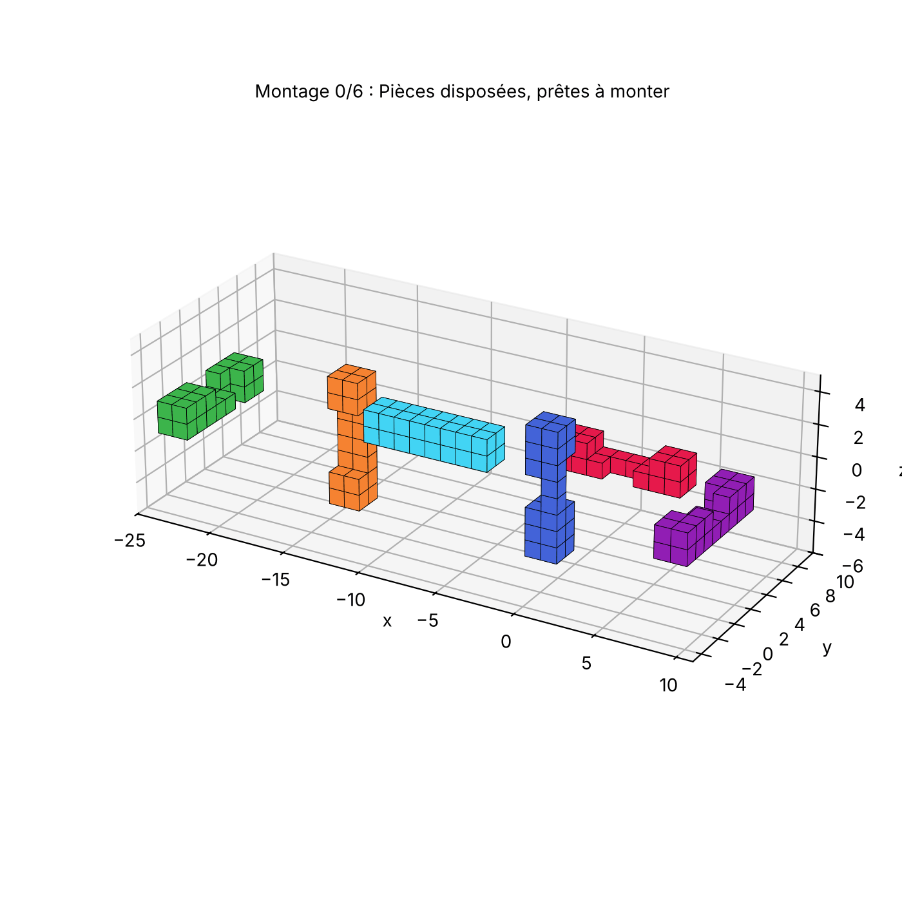
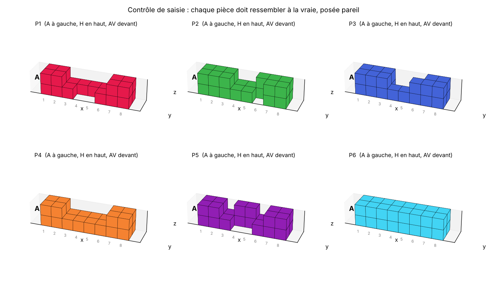

# burr-solver

Identifier et résoudre un casse-tête **burr à 6 pièces** (« casse-tête chinois »
en bois, pièces 2 × 2 × 8) à partir d'une simple table décrivant les entailles.



## Ce que fait l'outil

1. **Lit** une table CSV : une ligne par petit cube enlevé dans chaque pièce.
2. **Assemble** : essaie les 6 pièces dans les 6 emplacements et leurs
   8 orientations, garde les combinaisons sans chevauchement, puis retire les
   doublons dus aux symétries du cube et aux pièces identiques.
3. **Démonte** : recherche en largeur (BFS) sur les translations unitaires de
   pièces ou de groupes de pièces. Un assemblage qu'on ne peut pas démonter
   ne peut pas être monté en vrai : il est écarté.
4. **Affiche** l'emplacement et l'orientation de chaque pièce, le niveau du
   casse-tête et la séquence de démontage.
5. **Déduit le montage** : la séquence de démontage parcourue à l'envers, sens des
   mouvements inversés. Pour l'affichage, une partie qui se sépare est toujours
   éloignée du centre, sans chevaucher les pièces déjà posées à l'écart.
6. **Visualise** les pièces saisies, l'assemblage, le démontage et le montage animés.

## Installation

Clone ce dépôt (bouton « Code » sur GitHub), puis dans son dossier :

```bash
python3 -m venv .venv && source .venv/bin/activate
pip install -e ".[viz,dev]"
```

Le solveur seul n'a aucune dépendance. `matplotlib` et `pillow` ne servent
qu'à la visualisation.

## Utilisation

```bash
burr-solver pieces data/mes_pieces.csv   # contrôle de la table + code de chaque pièce
burr-solver solve  data/mes_pieces.csv   # solutions + démontage
burr-solver vue3d  data/mes_pieces.csv   # visionneuse 3D interactive -> outputs/vue3d.html
burr-solver viz    data/mes_pieces.csv   # images PNG + GIF du démontage et du montage dans outputs/
```

`vue3d.html` s'ouvre dans n'importe quel navigateur : toutes les pièces du lot
dans le repère de saisie, le burr assemblé, la vue éclatée, et un mode **Montage**
pas à pas (boutons précédent / suivant / lecture) : les pièces partent disposées
autour du burr et entrent une à une. On fait tourner la scène à la souris. Il faut une connexion internet (three.js est chargé depuis un CDN).

Sans installation : `PYTHONPATH=src python3 -m burr_solver solve data/mes_pieces.csv`.

## Décrire ses pièces

Voir [docs/convention.md](docs/convention.md). En bref : extrémité A à gauche,
face H (la plus entaillée) en haut, et pour chaque cube enlevé :

```
piece;unite;cube
P1;3;HAV
```

`data/mes_pieces.csv` (le burr qui a servi à développer l'outil) sert d'exemple.

### Contrôles automatiques
À la lecture, la table est refusée avec un message clair si :
- une pièce n'est pas d'un seul tenant (par exemple les 4 cubes d'une unité enlevés) ;
- un cube est enlevé hors des unités 3 à 6 ;
- une ligne est en double ou mal écrite ;
- il n'y a pas exactement 6 pièces.

### Code compact
Chaque pièce est résumée en 16 chiffres : 4 par unité (3 à 6), dans l'ordre
`HAV HAR BAV BAR`, 1 = cube enlevé. Exemple : `0000-0101-0111-0000`.



## Structure

```
src/burr_solver/
  geometry.py     repères, orientations, emplacements, symétries
  io.py           lecture, contrôles et code compact de la table CSV
  assembly.py     recherche des assemblages
  disassembly.py  recherche du démontage, étapes du montage
  viz.py          images et animation (matplotlib)
  viz3d.py        visionneuse 3D interactive (HTML + three.js)
  cli.py          commandes pieces / solve / vue3d / viz
data/             table des pièces de mon burr en bois
docs/             convention de saisie, images
tests/            tests pytest
```

## Tests

```bash
pytest
```

## Limites actuelles

- Pièces 2 × 2 × 8 uniquement, 6 pièces, assemblage « burr » classique.
- Les mouvements sont des translations d'une unité (pas de rotation de pièce).
- Pas encore de correspondance avec la numérotation de Bill Cutler.

## Licence

MIT, voir [LICENSE](LICENSE).
